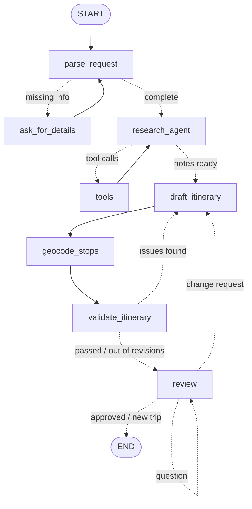

# ✈️ Trip Planner Agent

A travel-planning agent built with **LangGraph** and **Streamlit**. It uses two kinds of routing: small decisions about *where the graph goes next* are made by **SemIf**, a local *decision model*, and every LLM call is sent to **OpenRouter's Auto Router**, which picks *which model* answers it.

🔗 **Source code:** https://github.com/ktakeda122/LangGraph

You describe a trip in plain English, for example *"7 days in Guatemala, El Salvador and Honduras in December"*. The agent then:

1. asks for anything important you left out (where you're going, how many days),
2. looks up your destinations on Wikipedia, deciding for itself what to search,
3. writes a day-by-day itinerary,
4. finds every stop on a map,
5. checks the plan against simple rules and revises it if something is off,
6. shows you the plan and changes it based on your feedback until you approve it.

---

## Features

| | |
|---|---|
| 💬 **Chat interface** | Plan a trip in a conversation (`st.chat_input` / `st.chat_message`). |
| ❓ **Follow-up questions** | If the destination or trip length is missing, the agent pauses and asks for it. |
| 🔎 **Research agent** | A tool-calling loop: the LLM decides which Wikipedia searches to run, possibly several at once, and then writes research notes. Pages it read are listed as sources. |
| 🗺️ **Itinerary** | A structured day-by-day plan (Pydantic schema), shown in one tab per day, plus travel tips. |
| 📍 **Map** | Every stop is geocoded with OpenStreetMap and drawn on a pydeck map: one color per day, with stops connected in visiting order. You can filter the map by day, and a **Simple map** toggle (`st.map`) is available as a fallback. |
| 🧪 **Plan check** | Rule checks in plain Python, plus two semantic checks answered by the decision model (see [below](#plan-check-rules)). If a check fails, the plan goes back to the planner with the list of problems, up to 2 times. It stops early if a revision leaves exactly the same problems. |
| 🧠 **Decision model** | SemIf classifies your reply to each plan and runs the semantic plan checks. It returns a probability for each option, so the app trusts it only when it is confident and asks the LLM otherwise (see [Decision model](#decision-model-semif)). Every decision is listed in a **Decisions** panel with its probabilities. |
| 🧭 **Model router** | With an OpenRouter key, each LLM call goes to OpenRouter's Auto Router, which chooses a model for that request: a small one to read a sentence, a stronger one to write a plan (see [Model router](#model-router-openrouter-auto-router)). A **Models** panel lists every call with its model, the router's tier and effort, tokens and cost. Without the key, every call uses gpt-4.1-mini. |
| ✏️ **Human in the loop** | After each plan, the agent waits for your reply. *"Make day 2 more relaxed"* revises the plan, *"make it 6 days"* changes the trip length, *"looks good"* finishes, *"plan 5 days in Japan instead"* starts a new trip, and a question such as *"what's the weather like in December?"* gets an answer while the plan stays as it is. |
| 📡 **Live progress** | Each step of the graph appears as it runs, including a progress bar while places are being located. |

---

## Graph



Solid arrows are normal edges and dotted arrows are conditional edges. The app's sidebar shows the same diagram, generated from the compiled graph with `graph.get_graph().draw_mermaid()`.

### Nodes

| Node | Uses an LLM? | What it does |
|---|---|---|
| `parse_request` | ✅ structured output | Extracts destinations, days, season, budget and interests from the request (`TripRequest`). |
| `ask_for_details` | — | Calls `interrupt()` to ask for missing details, then appends the answer to the request. |
| `research_agent` | ✅ tool calling | Chooses Wikipedia searches (`bind_tools`) or, when it has enough, writes research notes. After 4 rounds it must stop searching. |
| `tools` | — | Runs the requested searches with `ToolNode` and collects the pages it read as sources. |
| `draft_itinerary` | ✅ structured output | Writes the itinerary (`Itinerary`). When revising, it also gets the previous plan, your change requests and/or the plan-check problems. |
| `geocode_stops` | — | Finds latitude and longitude for each day's city and each stop (OpenStreetMap Nominatim), and reports progress with `get_stream_writer()`. |
| `validate_itinerary` | 🧠 SemIf | Runs the [plan-check rules](#plan-check-rules). The two semantic rules go to SemIf in one request. |
| `review` | 🧠 SemIf, LLM only if needed | Calls `interrupt()` to show the plan and wait for your reply. SemIf then classifies the reply as approve, change, new trip or question, and says whether it changes the trip length. The LLM is called only when SemIf is unsure, to read the new number of days (`LengthChange`), or to answer a question. After an answer, the node runs again and waits for the next reply. Without SemIf, the LLM classifies the reply as in Step 5 (`FeedbackDecision`). |

Every "LLM" above goes through `call_llm()` in `llm_router.py`: OpenRouter's Auto Router when `OPENROUTER_API_KEY` is set, gpt-4.1-mini otherwise.

### LangGraph features used

- **`StateGraph` with a typed state** (`TripState`). Reducers handle list fields: `add_messages` for the research conversation and `operator.add` for sources.
- **Conditional edges** for routing, and **loops** (research ⇄ tools, plan check → revise, review → revise). Each loop has a cap, so none of them can run forever.
- **Tool calling** with `@tool(response_format="content_and_artifact")`. The LLM sees only the page summaries, while the app keeps the page URLs as sources.
- **Human in the loop** with `interrupt()` and `Command(resume=...)`.
- **Checkpointer** (`InMemorySaver`). The graph's state is saved per `thread_id` (one trip = one thread), and the UI reads the current plan with `graph.get_state()`.
- **Streaming** with `stream_mode=["updates", "custom"]`: node-by-node progress, plus custom events sent from inside a node.

---

## Decision model (SemIf)

[SemIf](https://github.com/TheoLeeCJ/SemIf-OpenJev) is an open take on TypeSafe's Jev. You give it a state, a question and a list of options, and it returns a probability for each option, read straight from the model's logits. It never generates text. It runs Qwen3.5-4B (Q4_K_M GGUF) on the CPU.

Many steps of this agent are really multiple-choice questions, and a chat LLM is a slow, expensive way to answer them. The app asks SemIf four kinds of question:

| Where | Question | Options | How the answer is used |
|---|---|---|---|
| `review` | What does the traveler want to do next? | `approve`, `change`, `new_trip`, `question` | Routes the conditional edge if the top probability is ≥ `ROUTE_CONFIDENCE` (0.90). Below that, the LLM decides. A `question` is answered by the LLM and the plan stays as it is. |
| `review` | Does the reply ask for a different number of days? | `yes`, `no` | A confident `no` skips the LLM. Otherwise the LLM reads the new number of days. |
| `validate_itinerary` | Does this itinerary spend time in *destination*? | `yes`, `no` | Asked only when the destination's name doesn't appear in the plan. The plan passes only on a confident `yes`. |
| `validate_itinerary` | Does at least one stop suit a traveler interested in *interest*? | `yes`, `no` | Fails the plan only on a confident `no` (≥ `CHECK_CONFIDENCE`, 0.80). |

Design choices:

- **The LLM writes, SemIf decides.** Text, itineraries and numbers still come from the LLM. SemIf can't answer outside its options, but it can still pick the wrong one.
- **Probabilities set the route, not just the choice.** Each threshold matches the cost of a mistake. The review step uses 0.90, chosen with `eval_router.py`: compared with 0.80, it stopped one confident mistake and sent only two more of 37 replies to the LLM. A failed check makes the LLM rewrite the plan, so a check fails only at ≥ 0.80.
- **Questions about one state go in one request.** The two review questions share one state, and so do all the plan checks. The server scores them in SemIf's *shared* mode, which reads the state once.
- **Everything still works without SemIf.** If the server isn't running, the router uses the LLM and the plan check uses the text rule, exactly as in Step 5. The sidebar shows whether SemIf is connected.
- **Every question gets an option that means "none of these".** A decision model must pick one of its options, so a reply that fits none of them still gets a confident answer. When the router only had `approve`, `change` and `new_trip`, SemIf labeled questions such as "Do I need a visa for Japan?" as `new_trip` with confidence 0.75–0.83, which would have restarted the trip. The `question` option gives those replies somewhere correct to go. Raising the threshold could not fix this, because the LLM fallback had the same three options.
- **Thresholds are tuned, not guessed.** SemIf's probabilities are not calibrated out of the box. `eval_router.py` runs labeled replies in three groups (easy, hard, questions). For each threshold, it shows how many decisions SemIf would make, how accurate they would be, and how many mistakes would be acted on.

---

## Model router (OpenRouter Auto Router)

The agent makes very different LLM calls: reading one sentence into a `TripRequest`, running a tool-calling research loop, writing a multi-day itinerary, answering a question. A single fixed model is either too weak for the hard ones or too expensive for the easy ones. With `OPENROUTER_API_KEY` set, every call goes to `openrouter/auto`, and OpenRouter's Auto Router picks a model for that request.

| Step | Purpose in the log | Router session |
|---|---|---|
| `parse_request` | Read the request | `<trip>-parse_request` |
| `research_agent` | Research / Write research notes | `<trip>-research_agent` |
| `draft_itinerary` | Draft / Revise the itinerary | `<trip>-draft_itinerary` |
| `review` | Read the new trip length, Classify the reply (only when SemIf can't decide) | `<trip>-review` |
| `review` (question) | Answer a question | `<trip>-answer_question` |

How it is set up (`llm_router.py`):

- **Settings follow the course demo (`autoroute_demo.py`).** The model is `openrouter/auto`, and its settings go in a plugin whose id is `auto-router`; settings under any other id are silently ignored. `X-OpenRouter-Metadata: enabled` returns the router's candidates and reason, and `usage: {include: true}` returns each request's cost.
- **One router session per trip and node.** The Auto Router keeps a session on one model unless the task changes. A session per node keeps the research loop on one model (and its prompt cache), while each step is still routed on its own. The demo uses a fresh session per request instead, because it compares unrelated prompts.
- **Structured output by function calling.** OpenRouter documents tool calling for every routed model, but not `json_schema` structured outputs, so `with_structured_output` uses `method="function_calling"`.
- **A fallback model.** If a routed call fails (an API error, or a structured output that doesn't parse), it is retried once on gpt-4.1-mini when `OPENAI_API_KEY` is set. The Models panel marks those calls with ⚠️.
- **Everything is logged.** Each call adds an entry to `llm_log` in the graph state: purpose, served model, the router's tier and effort, its candidates and reason, tokens, cost and time. The progress panel shows one 🧭 line per call, and the **Models** panel shows the whole trip with its total cost.

Optional settings in `.env`:

| Setting | Effect |
|---|---|
| `OPENROUTER_COST_TIER` | `low`, `medium` or `high`. Leave it unset to use the router's default policy. |
| `OPENROUTER_ALLOWED_MODELS` | Comma-separated patterns, e.g. `anthropic/*,openai/*,google/*`. Only these models can be chosen. |
| `OPENROUTER_EXCLUDED_MODELS` | Same syntax; these models are never chosen. |
| `USE_OPENROUTER=0` | Ignore the OpenRouter key and use gpt-4.1-mini for every call, to compare with the router. |

**Comparing with a fixed model.** Plan the same trip twice: once with the router, and once with `USE_OPENROUTER=0`. Restart Streamlit between the runs. Then compare the Models panels: which models were used for which steps, the tokens, the time and (for the router) the cost.

---

## Plan-check rules

`validate_itinerary` checks the plan with ordinary Python code where it can, so most results are deterministic. Distances are straight-line (haversine) distances between the geocoded points. Rules 2 and 7 need some understanding of places and activities, so they use SemIf.

| Rule | Default |
|---|---|
| The number of days matches the trip length | — |
| Every requested destination is visited: text match first, then SemIf for names the text match can't find (e.g. "Kyoto" when the day is based in "Arashiyama, Japan") | SemIf confidence ≥ 0.80 |
| Every interest is covered by at least one stop (SemIf only; skipped without SemIf) | fails at SemIf confidence ≥ 0.80, up to 5 interests |
| Stops per day | ≤ 4 |
| No place appears on two different days | — |
| Total distance between one day's stops, in visiting order | ≤ 100 km |
| A day that moves more than 150 km from the previous city is a light travel day | ≤ 2 stops |
| Automatic revisions per round (stops early if a revision leaves the same problems) | ≤ 2 |

The limits are constants at the top of `trip_planner.py` (`MAX_STOPS_PER_DAY`, `MAX_DAY_ROUTE_KM`, `TRANSFER_KM`, `ROUTE_CONFIDENCE`, `CHECK_CONFIDENCE`, ...).

---

## Setup

Requirements: Python 3.10+, [uv](https://docs.astral.sh/uv/), and an OpenAI API key and/or an OpenRouter API key.

```powershell
# 1. Install the dependencies (creates .venv from pyproject.toml / uv.lock)
uv sync

# 2. Create a .env file next to trip_planner.py (see below)

# 3. Run the app
uv run streamlit run trip_planner.py
```

If you are starting from just `trip_planner.py`, without `pyproject.toml`:

```powershell
uv init
uv add streamlit langgraph langchain-openai langchain-core python-dotenv wikipedia requests pydeck
```

### `.env`

```
OPENAI_API_KEY=sk-...
OPENROUTER_API_KEY=sk-or-...
CONTACT_EMAIL=you@example.com
# optional
SEMIF_URL=http://127.0.0.1:8765
SEMIF_TIMEOUT=60
# OPENROUTER_COST_TIER=low
# OPENROUTER_ALLOWED_MODELS=anthropic/*,openai/*,google/*
# USE_OPENROUTER=0      # uncomment to compare with gpt-4.1-mini
```

- `OPENAI_API_KEY`: used for `gpt-4.1-mini`, and as the fallback when a routed call fails. `OPENAI_API_TOKEN` also works.
- `OPENROUTER_API_KEY`: turns on the Auto Router for every LLM call. The other `OPENROUTER_*` settings and `USE_OPENROUTER` are described in [Model router](#model-router-openrouter-auto-router).
- `CONTACT_EMAIL`: added to the User-Agent sent to Wikipedia and OpenStreetMap. Both services ask clients to identify themselves and may block or rate-limit requests that don't. If it is missing, the app shows a warning in the sidebar.
- `SEMIF_URL` / `SEMIF_TIMEOUT`: where the SemIf server runs, and how many seconds to wait for one request before falling back to the LLM.

### SemIf server (optional, for the decision model)

`semif_server.py` keeps the SemIf model loaded and answers the app over HTTP. It runs in the SemIf environment from Lecture 7, not in this project's environment, because it needs `llama-cpp-python`, `transformers` and a 3 GB model file. On Windows, run it **inside WSL2**. The Streamlit app can stay in PowerShell: WSL2 forwards `localhost`.

```bash
# One-time setup (inside WSL)
git clone https://github.com/TheoLeeCJ/SemIf-OpenJev && cd SemIf-OpenJev
git checkout 23cf1f39fc9534fe81437200959b6dfc7106e45a
python3 -m venv .venv && . .venv/bin/activate
pip install torch==2.10.0 --index-url https://download.pytorch.org/whl/cpu
pip install -e '.[test,llamacpp]'
hf download bartowski/Qwen_Qwen3.5-4B-GGUF Qwen_Qwen3.5-4B-Q4_K_M.gguf --local-dir models

# Every time: start the server (path to this project as seen from WSL)
cd ~/SemIf-OpenJev && . .venv/bin/activate
python /mnt/c/path/to/Trip/semif_server.py --gguf models/Qwen_Qwen3.5-4B-Q4_K_M.gguf
```

The server prints `SemIf decision server on http://127.0.0.1:8765` when it is ready. After that it prints one line per request, with each choice and its confidence. Start the app afterwards. The sidebar should show **SemIf connected**.

- If the app can't reach the server from Windows, start it with `--host 0.0.0.0`. Then set `SEMIF_URL=http://<WSL IP>:8765`, where the WSL IP comes from `hostname -I`.
- `--threads N` limits the CPU cores SemIf uses.
- To check the router on labeled examples, and to pick `ROUTE_CONFIDENCE`, run `uv run python eval_router.py` while the server is running.

Never commit `.env`: add it to `.gitignore`.

---

## Usage

1. Type a request, for example:
   - `7 days in Tokyo and Kyoto in December, food and temples, mid budget`
   - `A trip to Guatemala and Honduras` (the agent will ask how many days)
2. Watch the progress panel as the agent researches, drafts, locates places and checks the plan. Each 🧭 line shows which model the router chose for that call.
3. Explore the result: the map (filter by day), the day tabs, travel tips, the plan-check results, the decisions SemIf made (with probabilities), the models the router chose (with tokens and cost), the research notes and the Wikipedia sources.
4. Reply in the chat:
   - `Day 2 is too busy, make it calmer` → revised plan
   - `Make it a 6 day trip` → trip length updated and plan redrafted
   - `Looks good!` → plan marked final
   - `Actually, plan 5 days in Japan instead` → starts a new trip
   - `What's the weather like in December?` → answered from the research notes, plan unchanged
5. **Start over** in the sidebar clears the conversation.

---

## Design notes

- **Rules in code, writing in the LLM.** The LLM does what it is good at: understanding requests, choosing searches and writing plans. Checks that need to be reliable, such as distances, counts and duplicates, run as plain Python. The check results are then given back to the LLM as concrete instructions.
- **Every loop has a limit.** At most 4 research rounds and 2 automatic revisions per round. When the limit is reached, the agent still shows its best plan and lists the problems that remain, instead of failing. If a revision leaves exactly the same problems, it stops early, because another try would most likely change nothing.
- **Geocoding safeguards.** The planner is told to name each stop by its official map name ("Palacio Nacional de la Cultura", not "Historic Center of Guatemala City"), because descriptive names return nothing on OpenStreetMap. Each stop is searched first as "Stop, City", then as "Stop" restricted to that city's country, and finally without descriptive words or parentheses ("Historic Center of Antigua (UNESCO)" → "Antigua"). A match more than 150 km from the city is treated as a wrong match and dropped. Results are cached (`st.cache_data`), requests are limited to 1 per second as Nominatim's usage policy requires, and lookups stop early if the service keeps returning errors. Those errors are shown in the app.
- **Changing the trip length is an edit, not a new trip.** When you ask for a different number of days, the trip details themselves are updated, so the planner, the plan check and the summary all use the new length. Different destinations start a new trip instead, because they need new research.

## Limitations

- The state is kept in memory (`InMemorySaver`), so plans are lost when the Streamlit server stops. `SqliteSaver` from `langgraph-checkpoint-sqlite` would keep them on disk.
- Research uses Wikipedia summaries only, so very specific facts (opening hours, prices, current events) may be missing or out of date.
- **Visa and entry requirements are not checked.** The agent is told not to state them as facts. Always confirm them on official government websites.
- Without SemIf, the destination rule only compares text, so a day based in "Arashiyama, Japan" does not count as visiting "Kyoto". With SemIf, such cases are checked by the model.
- SemIf is a 4B model and it can be wrong. Its probabilities are not calibrated as-is, which is why it decides only above a threshold and the LLM handles the rest. The thresholds are a starting point: tune them with `eval_router.py`.
- SemIf runs on the CPU. A request can take several seconds, depending on the machine and the length of the state. The plan checks read the whole itinerary, so they are the slowest. If requests time out, raise `SEMIF_TIMEOUT`.
- With the router, the model behind each step can change from run to run, so the same request can give different plans and costs. The cost comes from OpenRouter's usage report; gpt-4.1-mini calls show tokens only.
- A routed model may handle forced tool calls (used for structured output) worse than gpt-4.1-mini. Such calls fail over to gpt-4.1-mini; without an OpenAI key, they fail. `OPENROUTER_ALLOWED_MODELS` can limit the router to model families you trust.
- Distances are straight lines, not road or rail distances.

## Files

```
Trip/
├── trip_planner.py   # the app: graph, nodes, tools and Streamlit UI
├── llm_router.py     # every LLM call: OpenRouter Auto Router, or gpt-4.1-mini
├── decisions.py      # client for the SemIf server + the review questions
├── semif_server.py   # SemIf decision server (runs in the SemIf environment)
├── eval_router.py    # labeled replies: accuracy and coverage per threshold
├── pyproject.toml    # dependencies (uv)
├── uv.lock
├── .env              # API key and contact email (not committed)
└── README.md
```

## Credits

Built with [LangGraph](https://langchain-ai.github.io/langgraph/), [LangChain](https://python.langchain.com/), [Streamlit](https://streamlit.io/), [pydeck](https://deckgl.readthedocs.io/), [SemIf](https://github.com/TheoLeeCJ/SemIf-OpenJev) (Qwen3.5-4B) and [OpenRouter](https://openrouter.ai/docs/guides/routing/routers/auto-router)'s Auto Router. Data from [Wikipedia](https://www.wikipedia.org/) and [OpenStreetMap](https://www.openstreetmap.org/copyright) (© OpenStreetMap contributors, via Nominatim).