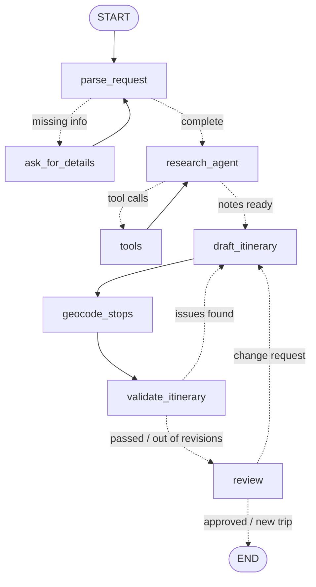

# ✈️ Trip Planner Agent

A travel-planning agent built with **LangGraph** and **Streamlit**.

You describe a trip in plain English, for example *"7 days in Guatemala, El Salvador and Honduras in December"*. The agent then:

1. asks for anything important you left out (where you're going, how many days),
2. looks up your destinations on Wikipedia, deciding for itself what to search,
3. writes a day-by-day itinerary,
4. finds every stop on a map,
5. checks the plan against simple rules and revises it if something is off,
6. shows you the plan and changes it based on your feedback until you approve it.

---

## Features

| | |
|---|---|
| 💬 **Chat interface** | Plan a trip in a conversation (`st.chat_input` / `st.chat_message`). |
| ❓ **Follow-up questions** | If the destination or trip length is missing, the agent pauses and asks for it. |
| 🔎 **Research agent** | A tool-calling loop: the LLM decides which Wikipedia searches to run, possibly several at once, and then writes research notes. Pages it read are listed as sources. |
| 🗺️ **Itinerary** | A structured day-by-day plan (Pydantic schema), shown in one tab per day, plus travel tips. |
| 📍 **Map** | Every stop is geocoded with OpenStreetMap and drawn on a pydeck map: one color per day, with stops connected in visiting order. You can filter the map by day, and a **Simple map** toggle (`st.map`) is available as a fallback. |
| 🧪 **Plan check** | Rule checks in plain Python, with no LLM (see [below](#plan-check-rules)). If a check fails, the plan goes back to the planner with the list of problems, up to 2 times. |
| ✏️ **Human in the loop** | After each plan, the agent waits for your reply. *"Make day 2 more relaxed"* revises the plan, *"make it 6 days"* changes the trip length, *"looks good"* finishes, and *"plan 5 days in Japan instead"* starts a new trip. |
| 📡 **Live progress** | Each step of the graph appears as it runs, including a progress bar while places are being located. |

---

## Graph



Solid arrows are normal edges and dotted arrows are conditional edges. The app's sidebar shows the same diagram, generated from the compiled graph with `graph.get_graph().draw_mermaid()`.

### Nodes

| Node | Uses an LLM? | What it does |
|---|---|---|
| `parse_request` | ✅ structured output | Extracts destinations, days, season, budget and interests from the request (`TripRequest`). |
| `ask_for_details` | — | Calls `interrupt()` to ask for missing details, then appends the answer to the request. |
| `research_agent` | ✅ tool calling | Chooses Wikipedia searches (`bind_tools`) or, when it has enough, writes research notes. After 4 rounds it must stop searching. |
| `tools` | — | Runs the requested searches with `ToolNode` and collects the pages it read as sources. |
| `draft_itinerary` | ✅ structured output | Writes the itinerary (`Itinerary`). When revising, it also gets the previous plan, your change requests and/or the plan-check problems. |
| `geocode_stops` | — | Finds latitude and longitude for each day's city and each stop (OpenStreetMap Nominatim), and reports progress with `get_stream_writer()`. |
| `validate_itinerary` | — | Runs the [plan-check rules](#plan-check-rules). |
| `review` | ✅ structured output | Calls `interrupt()` to show the plan and wait for your reply, then classifies the reply as approve, change (with an optional new trip length) or new trip (`FeedbackDecision`). |

### LangGraph features used

- **`StateGraph` with a typed state** (`TripState`). Reducers handle list fields: `add_messages` for the research conversation and `operator.add` for sources.
- **Conditional edges** for routing, and **loops** (research ⇄ tools, plan check → revise, review → revise). Each loop has a cap, so none of them can run forever.
- **Tool calling** with `@tool(response_format="content_and_artifact")`. The LLM sees only the page summaries, while the app keeps the page URLs as sources.
- **Human in the loop** with `interrupt()` and `Command(resume=...)`.
- **Checkpointer** (`InMemorySaver`). The graph's state is saved per `thread_id` (one trip = one thread), and the UI reads the current plan with `graph.get_state()`.
- **Streaming** with `stream_mode=["updates", "custom"]`: node-by-node progress, plus custom events sent from inside a node.

---

## Plan-check rules

`validate_itinerary` checks the plan with ordinary Python code, not an LLM, so its results are deterministic. Distances are straight-line (haversine) distances between the geocoded points.

| Rule | Default |
|---|---|
| The number of days matches the trip length | — |
| Every requested destination appears somewhere in the plan | — |
| Stops per day | ≤ 4 |
| No place appears on two different days | — |
| Total distance between one day's stops, in visiting order | ≤ 100 km |
| A day that moves more than 150 km from the previous city is a light travel day | ≤ 2 stops |
| Automatic revisions per round | ≤ 2 |

The limits are constants at the top of `trip_planner.py` (`MAX_STOPS_PER_DAY`, `MAX_DAY_ROUTE_KM`, `TRANSFER_KM`, ...).

---

## Setup

Requirements: Python 3.10+, [uv](https://docs.astral.sh/uv/), and an OpenAI API key.

```powershell
# 1. Install the dependencies (creates .venv from pyproject.toml / uv.lock)
uv sync

# 2. Create a .env file next to trip_planner.py (see below)

# 3. Run the app
uv run streamlit run trip_planner.py
```

If you are starting from just `trip_planner.py`, without `pyproject.toml`:

```powershell
uv init
uv add streamlit langgraph langchain-openai langchain-core python-dotenv wikipedia requests pydeck
```

### `.env`

```
OPENAI_API_KEY=sk-...
CONTACT_EMAIL=you@example.com
```

- `OPENAI_API_KEY`: used for `gpt-4.1-mini`. `OPENAI_API_TOKEN` also works.
- `CONTACT_EMAIL`: added to the User-Agent sent to Wikipedia and OpenStreetMap. Both services ask clients to identify themselves and may block or rate-limit requests that don't. If it is missing, the app shows a warning in the sidebar.

Never commit `.env`: add it to `.gitignore`.

---

## Usage

1. Type a request, for example:
   - `7 days in Tokyo and Kyoto in December, food and temples, mid budget`
   - `A trip to Guatemala and Honduras` (the agent will ask how many days)
2. Watch the progress panel as the agent researches, drafts, locates places and checks the plan.
3. Explore the result: the map (filter by day), the day tabs, travel tips, the plan-check results, the research notes and the Wikipedia sources.
4. Reply in the chat:
   - `Day 2 is too busy, make it calmer` → revised plan
   - `Make it a 6 day trip` → trip length updated and plan redrafted
   - `Looks good!` → plan marked final
   - `Actually, plan 5 days in Japan instead` → starts a new trip
5. **Start over** in the sidebar clears the conversation.

---

## Design notes

- **Rules in code, writing in the LLM.** The LLM does what it is good at: understanding requests, choosing searches and writing plans. Checks that need to be reliable, such as distances, counts and duplicates, run as plain Python. The check results are then given back to the LLM as concrete instructions.
- **Every loop has a limit.** At most 4 research rounds and 2 automatic revisions per round. When the limit is reached, the agent still shows its best plan and lists the problems that remain, instead of failing.
- **Geocoding safeguards.** Each stop is searched first as "Stop, City", then as "Stop" restricted to that city's country. A match more than 150 km from the city is treated as a wrong match and dropped. Results are cached (`st.cache_data`), requests are limited to 1 per second as Nominatim's usage policy requires, and lookups stop early if the service keeps returning errors. Those errors are shown in the app.
- **Changing the trip length is an edit, not a new trip.** When you ask for a different number of days, the trip details themselves are updated, so the planner, the plan check and the summary all use the new length. Different destinations start a new trip instead, because they need new research.

## Limitations

- The state is kept in memory (`InMemorySaver`), so plans are lost when the Streamlit server stops. `SqliteSaver` from `langgraph-checkpoint-sqlite` would keep them on disk.
- Research uses Wikipedia summaries only, so very specific facts (opening hours, prices, current events) may be missing or out of date.
- **Visa and entry requirements are not checked.** The agent is told not to state them as facts. Always confirm them on official government websites.
- The destination rule compares text: it looks for the destination name in the plan's city and stop names. A day based in "Arashiyama, Japan" does not count as visiting "Kyoto".
- Distances are straight lines, not road or rail distances.

## Files

```
Trip/
├── trip_planner.py   # the whole app: graph, nodes, tools and Streamlit UI
├── pyproject.toml    # dependencies (uv)
├── uv.lock
├── .env              # API key and contact email (not committed)
└── README.md
```

## Credits

Built with [LangGraph](https://langchain-ai.github.io/langgraph/), [LangChain](https://python.langchain.com/), [Streamlit](https://streamlit.io/) and [pydeck](https://deckgl.readthedocs.io/). Data from [Wikipedia](https://www.wikipedia.org/) and [OpenStreetMap](https://www.openstreetmap.org/copyright) (© OpenStreetMap contributors, via Nominatim).